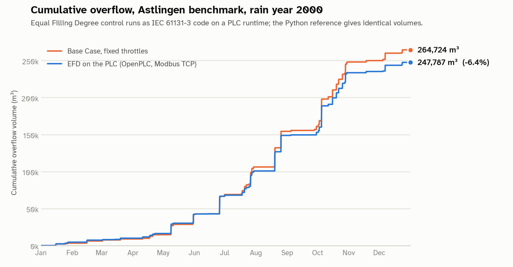
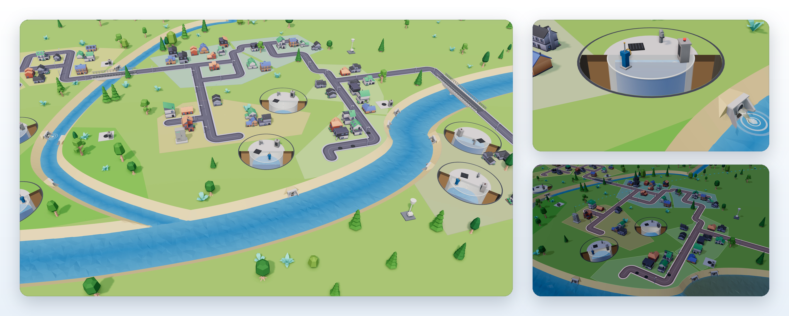
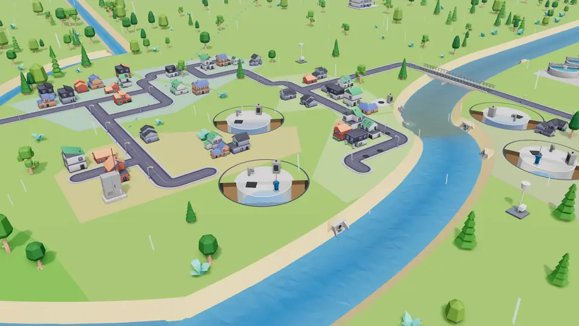
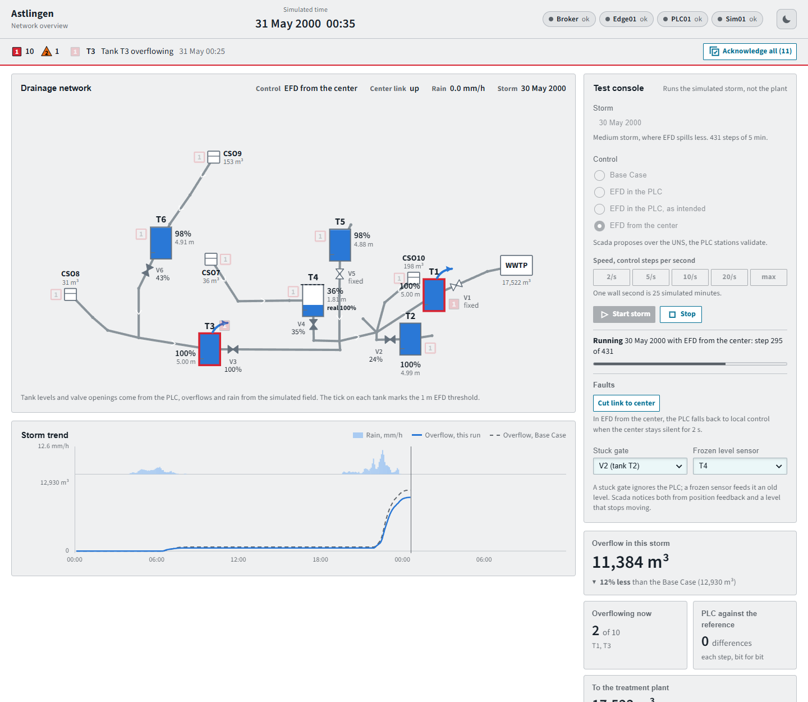
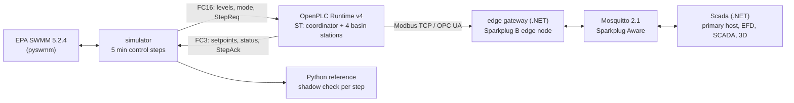
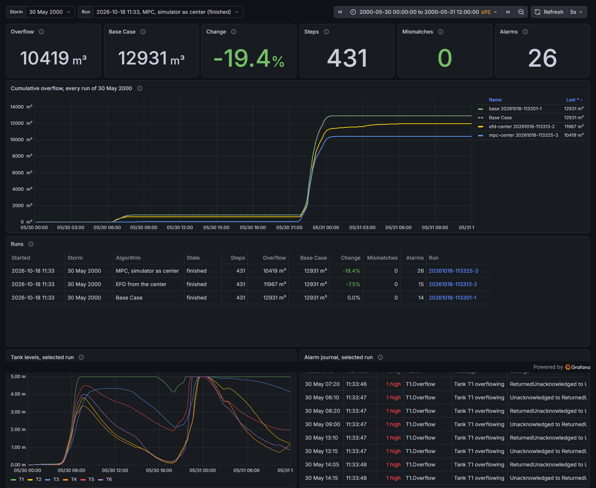

<p align="center">
  <picture>
    <source media="(prefers-color-scheme: dark)" srcset="docs/images/banner-dark.svg">
    
  </picture>
</p>

<p align="center">
  <a href="https://github.com/curiousvlxd/stormbench/actions/workflows/ci.yml"></a>
  <a href="LICENSE"></a>
  <a href="https://reuse.software"></a>
  <a href="https://doi.org/10.3390/w12041034"></a>
</p>

StormBench is an open, CI-testable software-in-the-loop testbed for real-time control (RTC) of combined sewers. EPA SWMM runs in closed loop with IEC 61131-3 PLC code on OpenPLC over Modbus TCP, with a Sparkplug B unified namespace, a central optimiser, an ISA-101 style operator SCADA and a live 3D view of the town.

The first benchmark network is the **Astlingen RTC Benchmarking Network** ([Sun et al. 2020](https://doi.org/10.3390/w12041034), model from [SWMM-Astlingen](https://github.com/open-toolbox/SWMM-Astlingen)); StormBench reproduces its published results. More networks will follow.

**Purpose:** test control logic for a sewer network as real PLC code, against a hydraulic model and a published benchmark, before it touches a real network.

> **Not for operational control of real infrastructure.** This is a teaching and test bench.

## Stack

| Area | Technologies |
|---|---|
| **Simulation** |     |
| **Control** |     |
| **Data path** |    |
| **SCADA and 3D** |       |
| **History and telemetry** |      |
| **Run** |    |

## Results

One rain year (2000) of the Astlingen benchmark, 105,406 control steps of 5 minutes.

| Overflow volume, m³ | Paper (SWMM 5.1.013) | This testbed (SWMM 5.2.4) |
|---|---:|---:|
| Base Case, fixed throttles | 264,731 | 264,724 |
| EFD, SWMM control rules | 247,788 (−6.4%) | 247,787 (−6.40%) |
| **EFD as IEC 61131-3 on the PLC** | | **247,787 (−6.40%)** |

- **Reproduction.** The published numbers of Sun et al. (2020) are matched to within a few m³ per overflow point, on a newer SWMM version.
- **PLC in the loop equals the reference, bit for bit.** Over the year the PLC's setpoints, the tank levels and all overflow volumes are identical to the Python reference; every PLC answer is cross-checked while the loop runs (0 mismatches).
- **Events and duration.** Overflow events drop from 283 to 244 with EFD; spill duration rises from 450 to 490 hours, because EFD moves overflow downstream (note 4).
- Tables per overflow point, event counts and spill hours: [`results/validation.md`](results/validation.md), [`results/kpi.csv`](results/kpi.csv).

<picture>
  <source media="(prefers-color-scheme: dark)" srcset="results/cumulative_overflow_dark.png">
  
</picture>

### Model predictive control

A second center: a linear program per 5 min step over a conceptual model read from the `.inp` (tanks, the orifice equation of each outlet, routing and delays), 100 min horizon, the cost weights of Sun et al. (2020, Table 3), solved with HiGHS. It proposes and the PLC stations check, as for EFD ([ADR 0017](docs/adr/0017-mpc-center.md)). Overflow in m³:

| Storm | Base Case | EFD | MPC | MPC, no forecast |
|---|---:|---:|---:|---:|
| 30 May 2000, 36 hours | 12,931 | 11,967 (−7.5%) | 10,419 (−19.4%) | 10,323 (−20.2%) |
| 29 May to 1 June 2000 | 13,476 | 12,070 (−10.4%) | 10,533 (−21.8%) | 10,576 (−21.5%) |
| 4 October 2000 | 28,345 | 28,260 (−0.3%) | 27,760 (−2.1%) | 27,714 (−2.2%) |
| 19 August 2000 | 25,659 | 25,800 (+0.5%) | 24,036 (−6.3%) | 24,157 (−5.9%) |
| **Year 2000** | **264,724** | **247,787 (−6.40%)** | **201,934 (−23.72%)** | **214,716 (−18.89%)** |
| Year 2000, paper | 264,731 | 247,788 (−6.40%) | 229,750 (−13.21%) | |

- **A perfect-forecast MPC is an upper bound.** As in the paper, the MPC knows the inflows of the next 100 min exactly (from a pre-run of the same storm). "No forecast" holds the last measured inflow: almost as good in the storms, 4.8 points behind over the year. Most of the gain comes from using outlets and storage together, not from foresight.
- **Fast enough for the loop:** 7.5 ms per solve on average, 74 ms at most, no failed solve in 105,406 steps.
- **Through the PLC:** the storm of 30 May with MPC from the console gives the same 10,419 m³ with 0 mismatches. Tables per point: [`results/controllers.md`](results/controllers.md). Plug in your own algorithm: [docs/controllers.md](docs/controllers.md).

### What a fault costs, and whether SCADA sees it

Each fault injected at 20:50 on 30 May, an hour before the downpour, on the full stack; spills counted with the 12/24 method of the English regulators ([Ofwat](https://www.ofwat.gov.uk/wp-content/uploads/2023/05/Storm-overflows-PC-definition.pdf)). Base Case: 12,931 m³, 12 spills.

| Control | Fault | Overflow | vs Base Case | Spills | SCADA alarm after |
|---|---|---:|---:|---:|---:|
| EFD from the center | none | 11,967 m³ | −7.5% | 11 | |
| | link to the center cut | 11,372 m³ | −12.1% | 11 | 10 min |
| | gate V2 stuck | 11,860 m³ | −8.3% | 11 | 15 min |
| | level sensor T4 frozen | 11,967 m³ | −7.5% | 11 | 35 min |
| MPC | none | 10,419 m³ | −19.4% | 9 | |
| | link to the center cut | 10,410 m³ | −19.5% | 11 | 0 min |
| | gate V2 stuck | 11,033 m³ | −14.7% | 10 | 50 min |
| | level sensor T4 frozen | 10,930 m³ | −15.5% | 10 | 40 min |

Every fault raised its alarm and every PLC answer matched the reference. **The center can be worse than no center:** with EFD, losing the link before the downpour spilled less, because the published EFD rules do worse in a cloudburst than the stations' local settings the PLC falls back to. Finding this before a rollout is what the testbed is for. Full table: [`results/faults/faults.md`](results/faults/faults.md); regenerate with `uv run python -m stormbench_sim.faultmatrix` against a running stack.

## Run it

Requirements: Docker with Compose and about 6 GB of free disk. The first run downloads 130 MB of benchmark data.

```bash
docker compose -f compose.uns.yaml up --build
```

Open http://localhost:18080. The page lists the benchmarks; **Open sandbox** on Astlingen shows the Live 3D view, and the operator SCADA is at `/benchmarks/astlingen/operator`. Choose a storm and a control strategy and press **Start storm**. With the .NET 10 SDK, `dotnet run --project src/StormBench.AppHost` starts the same stack under Aspire, with a dashboard for logs, traces and metrics.

The validation pipeline, as CI runs it (about five minutes once the images are built):

```bash
docker compose up --build --exit-code-from simulator
```

It downloads the benchmark model (pinned commit, SHA-256 checked), builds the PLC image from `plc/src/*.st`, runs four reference simulations and the PLC-in-the-loop year, and writes `results/`: the validation report, KPIs, charts and storm animations.

<details>
<summary>More commands</summary>

```bash
docker compose up --build --detach --wait plc      # only the PLC; Modbus TCP on localhost:1502
cd simulator && uv sync                             # local Python environment (Python 3.11+)
uv run python -m stormbench_sim --model-dir ../models/astlingen --results-dir ../results run efd-plc --control plc --mode efd-published --plc-host localhost --plc-port 1502
uv run python -m stormbench_sim --model-dir ../models/astlingen --results-dir ../results compare --year   # Base Case, EFD, MPC offline (about 15 minutes)
uv run pytest -m "not model and not plc"            # unit tests
PLC_HOST=localhost PLC_PORT=1502 uv run pytest -m "model or plc"   # reference and PLC-in-the-loop tests
docker compose -f compose.uns.yaml --profile check up --build --exit-code-from check   # the UNS chain without a browser
```

On Linux and macOS: `make demo`, `make plc`, `make test-plc`.

</details>

## Live 3D view

<p align="center"></p>

The town in a storm, laid out as the benchmark's own map (subcatchments and rain gauges from the `.inp`, Main River, Park Creek and the park traced from its georeferenced backdrop), fed by the same live data as the operator SCADA ([ADR 0014](docs/adr/0014-live-3d-view.md)).

- **Underground, as built.** On the surface only manhole covers, the tanks' roof slabs with kiosks and gate headstocks, and the outfalls in the river banks. An x-ray lens over each tank shows it cut in half: the water at its live level against a staff gauge, the penstock on its wall.
- **Live.** Tanks fill, gates move, outfalls pour into the river and the plume grows with each spill; day and night follow the simulated clock. The scoreboard compares the run with the same storm without smart control.
- **Break it on purpose.** Cut the link to the control room, jam a gate, freeze a level sensor, and read whether SCADA noticed.
- TypeScript and three.js ([`src/StormBench.Live`](src/StormBench.Live)); the structures are modelled in Blender ([`assets/models`](assets/models/README.md)), the town uses Kenney's CC0 kits.

<p align="center"></p>

## Operator SCADA

<p align="center"></p>

Part of Scada (Blazor, interactive server rendering), reading only the unified namespace ([ADR 0010](docs/adr/0010-operator-hmi-from-the-uns.md)), in one design system with the Live 3D view, light by default with a dark theme ([ADR 0013](docs/adr/0013-ix-design-system.md)).

- **Drawn from data.** The simulator is a second Sparkplug edge node, `Sim01`, that publishes the network and, every 5 minutes of model time, rain, overflow per point and the inflow to the treatment plant. The display places every symbol from the model's coordinates and finds room for every label itself.
- **ISA-101 and ISA-18.2.** Grey process, colour only for water and alarms; each alarm priority has a colour, a shape and a number, and an alarm leaves the list only when it has cleared and been acknowledged. Stale values stay visible, greyed, with a question mark.
- **Field faults and a watchdog.** A stuck gate or a frozen level sensor is found from position feedback and from a level that stops moving ([ADR 0012](docs/adr/0012-field-faults.md)); when the center goes silent for 2 s the PLC stations run locally ([ADR 0011](docs/adr/0011-center-watchdog.md)).
- **Test console through the UNS.** Storm, control and speed go to `Sim01` as an NCMD; the Base Case of the same storm runs first, so the key figure compares both at the same moment. The console runs the simulated storm, never the plant.

## How it works



- **Lockstep.** Every 5 minutes of model time the simulator writes tank levels and a request number in one Modbus request and waits until the PLC echoes it. Results never depend on the speed of either side ([ADR 0003](docs/adr/0003-modbus-lockstep.md), [register map](docs/modbus-map.md)).
- **Structured Text, structured like an installation.** A coordinator block proposes EFD setpoints; four station blocks accept them only within limits and while coordination is healthy, and otherwise fall back to their local setting ([ADR 0004](docs/adr/0004-protection-in-the-plc.md), [`plc/src`](plc/src)). The ST is compiled to C++ with STruC++ during `docker build`, so the runtime boots straight into RUNNING ([ADR 0002](docs/adr/0002-openplc-v4-headless-build.md)).
- **Sparkplug B 3.0, done properly.** bdSeq in the will and the birth, sequence numbers, rebirth on request, births only after the primary host's STATE is online; Scada marks everything stale on NDEATH or when it loses the broker. The Sparkplug library is the testbed's own ([ADR 0008](docs/adr/0008-own-sparkplug-library.md)), tested against a real Mosquitto in Testcontainers.
- **The center only proposes.** In mode 3 the setpoints come from a central optimiser that knows the network only through the unified namespace; the PLC stations take a proposal only within their limits and while the link is up ([ADR 0007](docs/adr/0007-uns-and-central-optimiser.md)). The whole chain gives the same 247,787 m³ for the year, with 0 of 105,406 PLC answers differing; one step through PLC, gateway, broker, Scada and back takes about 3 ms.
- **OPC UA too.** The PLC serves every located variable read-only over OPC UA; the gateway can read it with the OPC Foundation .NET stack instead of Modbus (`Plc__Driver=OpcUa`), with the same volumes ([ADR 0009](docs/adr/0009-opcua-read-path.md)).
- **No wall-clock timers in the logic**, so fast runs, paced demo runs and slow machines give the same numbers ([ADR 0006](docs/adr/0006-simulated-time.md)).

More in [docs/architecture.md](docs/architecture.md). Watch the namespace with any MQTT client on `localhost:31883` (`spBv1.0/#`), or read Scada's view at `/api/uns`.

## Trends and run history

Every control step goes to VictoriaMetrics, stamped with the storm's model time, so runs of the same storm lie on top of each other. Run summaries and every alarm state change go to PostgreSQL ([ADR 0015](docs/adr/0015-historian-and-run-store.md)); the services, the simulator included, send metrics, traces and logs over OpenTelemetry to VictoriaMetrics and VictoriaLogs ([ADR 0016](docs/adr/0016-observability.md)).



| | Grafana | VictoriaMetrics | VictoriaLogs | PostgreSQL |
|---|---|---|---|---|
| `docker compose -f compose.uns.yaml up` | http://localhost:33000 | :38428 (`/vmui`) | :39428 (`/select/vmui`) | :35432 |
| Aspire AppHost | http://localhost:23000 | :28428 | :29428 | :25432 |

Without Grafana: `GET /api/runs` and `GET /api/alarms/journal?run=<id>` on Scada.

## Engineering notes

1. **Half of the published EFD rules never fire in SWMM.** SWMM gives equal-priority rules first-listed precedence, so in `EFD_Control.txt` only "open the fullest tank fully" is ever active. First reported in [SWMM-Astlingen PR #1](https://github.com/open-toolbox/SWMM-Astlingen/pull/1); the ST implements both variants, "as published" (reproduces the paper) and "as intended" (−6.49% for the year) ([ADR 0005](docs/adr/0005-swmm-version-and-validation.md)).
2. **A real integration race, found by the shadow check.** OpenPLC Runtime v4 commits changed outputs one by one, in declaration order, without holding the image lock: with the acknowledge variable declared first, 3 of 105,406 steps returned the new acknowledgement with the previous setpoints. Declaring `StepAck` last fixed it; a unit test guards the order ([register map](docs/modbus-map.md#why-stepreq-and-stepack-are-declared-last)).
3. **RTC pays off in medium storms, not in the largest.** On 30 May EFD spills 12,070 instead of 13,427 m³ (−10%); in the largest storm of the year every basin overflows regardless of control (−1.7%).
4. **EFD moves overflow downstream.** Over the year it cuts volume by 6.4% and events from 283 to 244, but T1, the last uncontrolled tank before the treatment plant, spills for 248 hours instead of 105.
5. **Two tooling traps.** `swmm_start` resets link settings, so settings written before the first step are lost; STruC++ 0.6.9 generates code that does not compile for `NOT (a AND b)` with two comparisons.
6. **A typo in the reference.** The paper's CSO10 value under EFD (4,751 m³) should read 4,741: CSO10 lies upstream of every controlled outlet, and the paper's EFD total only adds up with 4,741.
7. **Nagle's algorithm cost 40 ms per step.** Mosquitto does not set `TCP_NODELAY` by default; `set_tcp_nodelay true` made the UNS loop seven times faster.
8. **A broker crash in the Sparkplug Aware plugin.** Mosquitto 2.1.2 exits with SIGSEGV on the second NBIRTH if births carry MQTT 5 properties; the testbed's clients send none, and a test covers it.
9. **Exact equality is per platform.** The Windows and Linux builds of SWMM differ by up to 3e-14 m in tank level for the same run; golden values are rounded to 0.001 m³.

## Related work

Testing PLC code against a process model (virtual commissioning) is established practice, and ifak's commercial [SIMBA#](https://www.ifak.eu/en/produkte/simba) has let engineers write sewer controllers in a PLC language for years. We are not aware of an open-source project that runs sewer-network RTC logic as IEC 61131-3 code on a PLC runtime in closed loop with EPA SWMM over Modbus TCP or OPC UA (checked September 2026).

| Project | What it does | Difference |
|---|---|---|
| [DHALSIM](https://github.com/Critical-Infrastructure-Systems-Lab/DHALSIM) | EPANET drinking-water networks with emulated Python PLCs | Drinking water; PLCs are Python, not IEC 61131-3 |
| [AAU Smart Water Lab](https://github.com/kballamark/LB-GP-based_WWnetwork_control) | CODESYS PLCs over Modbus on a physical lab-scale sewer | Physical rig, no SWMM |
| [pystorms](https://github.com/kLabUM/pystorms) | Control scenarios on pyswmm, Astlingen as scenario "zeta" | No PLC, no industrial protocol |
| [SWMM-Astlingen](https://github.com/open-toolbox/SWMM-Astlingen) | The benchmark model and EFD rules used here; MPC via pyswmm | No PLC, no industrial protocol |
| [ifakFAST Mediator.Net](https://github.com/ifakFAST/Mediator.Net) | OPC UA / Modbus / MQTT middleware for process simulation | Middleware, not a SWMM and PLC bench |
| [RIWWER](https://github.com/calgo-lab/RIWWER_TimeSeries) | SWMM models incl. Astlingen with MQTT data flows | Embedded hardware, no PLC runtime |

## Repository layout

```
plc/            IEC 61131-3 ST program, STruC++ bundler, OpenPLC v4 Dockerfile
simulator/      Python: SWMM runner, reference controller, MPC, Modbus lockstep, KPIs, report,
                Sparkplug edge node Sim01 with the test console, a template center, tests
src/            .NET 10: Sparkplug B library, contracts, edge gateway, Scada with the SCADA and
                the Live 3D view (TypeScript in src/StormBench.Live), Aspire AppHost
tests/          .NET tests (xUnit v3, Testcontainers)
assets/models/  Blender source of the 3D structures and the export pipeline
deploy/         Mosquitto configuration, Grafana data sources and dashboard
models/         fetch script for the Astlingen benchmark (downloaded, not committed)
docs/           architecture, Modbus register map, ADRs, images
results/        validation report, KPIs, charts, animations (generated)
fonts/          Source Sans 3 and Atkinson Hyperlegible Next (OFL)
```

## Roadmap

Done: the software-in-the-loop core, the industrial data path with the unified namespace, the operator SCADA with alarms and the test console, the Live 3D view, historian, run history and alarm journal, OpenTelemetry and Grafana, field faults, the center watchdog, and MPC as a second center with a plugin interface ([ADR 0017](docs/adr/0017-mpc-center.md)). Next: the MPC as a Scada module in .NET, an MPC with an uncertain forecast, sensor noise, and more benchmark networks (candidates: the [pystorms](https://github.com/kLabUM/pystorms) scenarios and Bellinge).

## Credits and data

- **Astlingen benchmark, SWMM implementation:** developed by Congcong Sun (IRI, CSIC-UPC) under the supervision of Manfred Schütze (ifak), Morten Borup and Luca Vezzaro (DTU), https://github.com/open-toolbox/SWMM-Astlingen. Reference: Sun, C.; Svensen, J.L.; Borup, M.; Puig, V.; Cembrano, G.; Vezzaro, L. An MPC-Enabled SWMM Implementation of the Astlingen RTC Benchmarking Network. Water 2020, 12(4), 1034, https://doi.org/10.3390/w12041034. The benchmark goes back to the DWA working group on RTC (Schütze et al., Water Science & Technology, 2017). The model files carry no license and are downloaded from the original repository, not redistributed.
- EPA SWMM, [pyswmm](https://github.com/pyswmm/pyswmm), [OpenPLC Runtime v4](https://github.com/Autonomy-Logic/openplc-runtime), [STruC++](https://github.com/Autonomy-Logic/STruCpp), [pymodbus](https://github.com/pymodbus-dev/pymodbus), [MQTTnet](https://github.com/dotnet/MQTTnet), [Eclipse Mosquitto](https://mosquitto.org), the Sparkplug B schema from [Eclipse Tahu](https://github.com/eclipse-tahu/tahu), [Aspire](https://aspire.dev), [VictoriaMetrics and VictoriaLogs](https://github.com/VictoriaMetrics), [PostgreSQL](https://www.postgresql.org) with [Npgsql](https://github.com/npgsql/npgsql) and [Dapper](https://github.com/DapperLib/Dapper), [Grafana](https://github.com/grafana/grafana), [three.js](https://threejs.org), Kenney's CC0 kits. Third-party licenses: [NOTICE](NOTICE).

## License

Code: Apache-2.0 ([LICENSE](LICENSE)). Documentation, diagrams and results: CC BY 4.0. Fonts: SIL OFL 1.1. The repository follows the [REUSE](https://reuse.software) specification.
