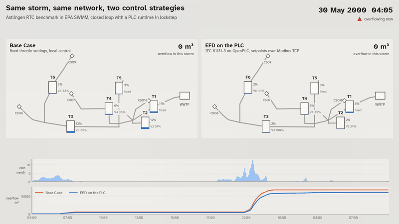
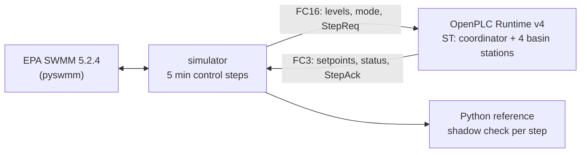
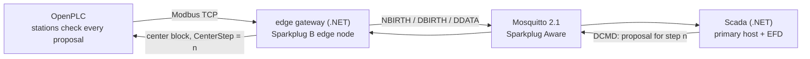

# StormBench

A test bench for sewer control code. An open, CI-testable software-in-the-loop testbed for combined-sewer real-time control (RTC): EPA SWMM in closed loop with IEC 61131-3 PLC code on OpenPLC over Modbus TCP, a Sparkplug B unified namespace with a central optimiser, and an ISA-101 style operator HMI.

**Benchmark 1: Astlingen.** The first benchmark network is the Astlingen RTC benchmark ([Sun et al. 2020](https://doi.org/10.3390/w12041034), model from [SWMM-Astlingen](https://github.com/open-toolbox/SWMM-Astlingen)), and StormBench reproduces its published results. More benchmark networks will follow.

**The point:** test control logic for a sewer network as real PLC code, against a hydraulic model and a published benchmark, before it touches a real network.

> **Not for operational control of real infrastructure.** This is a teaching and test bench.



*30 May 2000, Astlingen benchmark. Left: fixed throttles. Right: Equal Filling Degree (EFD) computed by Structured Text on OpenPLC, setpoints over Modbus TCP, model and PLC in lockstep. EFD keeps the four controlled tanks at the same filling degree and spills less.*

## Results

One rain year (2000) of the Astlingen benchmark, 105,406 control steps of 5 minutes.

| Overflow volume, m³ | Paper (SWMM 5.1.013) | This testbed (SWMM 5.2.4) |
|---|---:|---:|
| Base Case, fixed throttles | 264,731 | 264,724 |
| EFD, SWMM control rules | 247,788 (−6.4%) | 247,787 (−6.40%) |
| **EFD as IEC 61131-3 on the PLC** | | **247,787 (−6.40%)** |

- **Reproduction:** the testbed matches the published numbers of Sun et al. (2020) to within a few m³ per overflow point on a newer SWMM version.
- **PLC in the loop = reference, bit for bit:** over the whole year the PLC's setpoints, the resulting tank levels and all overflow volumes are identical to the Python reference, and every single PLC answer is cross-checked while the loop runs (0 mismatches).
- Overflow events (Entlastungsereignisse, per point, summed): 283 in the Base Case, 244 with EFD. Spill duration rises from 450 to 490 hours because EFD moves overflow downstream (note 4 below).
- Full tables per overflow point, event counts and spill hours: [`results/validation.md`](results/validation.md), [`results/kpi.csv`](results/kpi.csv).

<picture>
  <source media="(prefers-color-scheme: dark)" srcset="results/cumulative_overflow_dark.png">
  
</picture>

### Model predictive control

A second center: a linear program per 5 min step over a conceptual model read from the `.inp` (tanks, the orifice equation of each outlet, routing and delays), 100 min horizon, cost weights of Sun et al. (2020, Table 3), solved with HiGHS. It proposes, the PLC stations check, as for EFD ([ADR 0017](docs/adr/0017-mpc-center.md)). Python only, proposals checked by the Python reference of the stations; overflow in m³:

| Storm | Base Case | EFD | MPC | MPC, no forecast |
|---|---:|---:|---:|---:|
| 30 May 2000, 36 hours | 12,931 | 11,967 (−7.5%) | 10,419 (−19.4%) | 10,323 (−20.2%) |
| 29 May to 1 June 2000 | 13,476 | 12,070 (−10.4%) | 10,533 (−21.8%) | 10,576 (−21.5%) |
| 4 October 2000 | 28,345 | 28,260 (−0.3%) | 27,760 (−2.1%) | 27,714 (−2.2%) |
| 19 August 2000 | 25,659 | 25,800 (+0.5%) | 24,036 (−6.3%) | 24,157 (−5.9%) |
| **Year 2000** | **264,724** | **247,787 (−6.40%)** | **201,934 (−23.72%)** | **214,716 (−18.89%)** |
| Year 2000, paper | 264,731 | 247,788 (−6.40%) | 229,750 (−13.21%) | |

- **A perfect-forecast MPC, an upper bound.** As in the paper, the MPC knows the inflows of the next 100 min exactly, here from a pre-run of the same storm. *No forecast* holds the last measured inflow instead: it does almost as well in the storms and gives up 4.8 points over the year, so most of the gain comes from using the outlets and the storage together, not from foresight.
- **Fast enough for the loop:** 7.5 ms per solve on average over the year, 74 ms at most; no failed solve in 105,406 steps.
- **In the console** as "MPC, simulator as center": the simulator plays the center and writes its proposals to the PLC, which checks them in mode 3; Scada's EFD stands aside for that run. Tables per point: [`results/controllers.md`](results/controllers.md). Plug in your own algorithm: [docs/controllers.md](docs/controllers.md).

- **Through the PLC:** the storm of 30 May with MPC from the console, PLC in the loop, gives the same 10,419 m³ with 0 mismatches.

### What a fault costs, and whether Scada sees it

Each fault injected at 20:50 on 30 May, an hour before the downpour, on the full stack; spills counted with the 12/24 method the English regulators use ([Ofwat](https://www.ofwat.gov.uk/wp-content/uploads/2023/05/Storm-overflows-PC-definition.pdf)). Base Case: 12,931 m³, 12 spills.

| Control | Fault | Overflow | vs Base Case | Spills | Scada alarm after |
|---|---|---:|---:|---:|---:|
| EFD from the center | none | 11,967 m³ | −7.5% | 11 | |
| | link to the center cut | 11,372 m³ | −12.1% | 11 | 10 min |
| | gate V2 stuck | 11,860 m³ | −8.3% | 11 | 15 min |
| | level sensor T4 frozen | 11,967 m³ | −7.5% | 11 | 35 min |
| MPC | none | 10,419 m³ | −19.4% | 9 | |
| | link to the center cut | 10,410 m³ | −19.5% | 11 | 0 min |
| | gate V2 stuck | 11,033 m³ | −14.7% | 10 | 50 min |
| | level sensor T4 frozen | 10,930 m³ | −15.5% | 10 | 40 min |

- Every fault raised its alarm, in model time after the fault; every PLC answer matched the reference (0 mismatches in all runs).
- **The center can be worse than no center.** With EFD, losing the link before the downpour spilled *less*: the published EFD rules do worse in a cloudburst than the stations' local settings the PLC falls back to. MPC loses nothing when the link drops at that moment, and a jammed gate or a frozen sensor costs it about 500 to 600 m³. Finding this before a rollout is what the testbed is for. Full table: [`results/faults/faults.md`](results/faults/faults.md), regenerate with `uv run python -m stormbench_sim.faultmatrix` against a running stack.

## Run it

Requirements: Docker with Compose (Docker Desktop on Windows or macOS works) and about 6 GB of free disk for the images. The first run also downloads 130 MB of benchmark data.

**The testbed with its operator HMI:**

```bash
docker compose -f docker-compose.uns.yml up --build
```

Open http://localhost:18080, choose a storm and a control strategy and press **Start storm**. The page opens on the Live 3D view; the operator display with alarms and trends is at `/operator`. PLC, edge gateway, broker, Scada and simulator run in containers; the HMI shows the network, alarms, key figures and the trend while the storm runs. With the .NET 10 SDK, `dotnet run --project src/StormBench.AppHost` starts the same stack under Aspire, with a dashboard for logs, traces and metrics; the HMI is the link of the `scada` resource.

**The validation pipeline:**

```bash
docker compose up --build --exit-code-from simulator
```

This downloads the benchmark model from its original repository (pinned commit, SHA-256 checked), builds the PLC image from `plc/src/*.st`, starts OpenPLC, runs four reference simulations and the PLC-in-the-loop year, and writes `results/`: the validation report, KPIs, charts and two storm animations (MP4, plus a GIF of the first). On a desktop PC the pipeline takes about five minutes once the images are built (measured: 289 s, of which 139 s for the PLC-in-the-loop year).

Useful variations:

```bash
docker compose up --build --detach --wait plc      # only the PLC; Modbus TCP on localhost:1502
cd simulator && uv sync                             # local Python environment (Python 3.11+)
uv run python -m stormbench_sim --model-dir ../models/astlingen --results-dir ../results run efd-plc --control plc --mode efd-published --plc-host localhost --plc-port 1502
uv run python -m stormbench_sim --model-dir ../models/astlingen --results-dir ../results compare --year   # Base Case, EFD, MPC offline (about 15 minutes)
uv run pytest -m "not model and not plc"            # unit tests
PLC_HOST=localhost PLC_PORT=1502 uv run pytest -m "model or plc"   # reference + PLC-in-the-loop tests
```

On Linux and macOS the same is available as `make demo`, `make plc`, `make test-plc`.

## How it works



- **Lockstep.** Every 5 minutes of model time the simulator writes tank levels and a request number in one Modbus request and waits until the PLC echoes it; only then does the model advance. Results never depend on the speed of either side. At a 1 ms task interval a year of handshakes takes about two minutes. ([ADR 0003](docs/adr/0003-modbus-lockstep.md), [register map](docs/modbus-map.md))
- **Structured Text, structured like an installation.** One coordinator block proposes EFD setpoints; four station blocks accept them only within limits and while coordination is healthy, and otherwise fall back to their local Base Case setting. ([ADR 0004](docs/adr/0004-protection-in-the-plc.md), [`plc/src`](plc/src))
- **No GUI in the loop.** The ST is compiled to C++ with STruC++ (the compiler the OpenPLC Editor uses) during `docker build`, so the runtime boots straight into RUNNING. ([ADR 0002](docs/adr/0002-openplc-v4-headless-build.md))
- **No wall-clock timers in the logic**, so fast runs, paced demo runs and slow machines give the same numbers. ([ADR 0006](docs/adr/0006-simulated-time.md))

More in [docs/architecture.md](docs/architecture.md).

## The industrial data path: unified namespace over Sparkplug B

In mode 3 the setpoints are proposed by a central optimiser that knows the network only through the unified namespace, as in a real installation:



- **Sparkplug B 3.0, done properly.** The edge gateway publishes the PLC as device `PLC01` of edge node `Edge01` in group `Astlingen`, by exception, with bdSeq in the will and the birth, sequence numbers, rebirth on request, and births only after the primary host's STATE is online. Scada is the primary host: it keeps the UNS state with a quality per metric and marks everything stale on NDEATH or when it loses the broker. The small Sparkplug library is the testbed's own ([ADR 0008](docs/adr/0008-own-sparkplug-library.md)).
- **The center only proposes.** The PLC stations take the proposal only within their limits and while the link is up; otherwise they run the Base Case. For determinism the center is part of the lockstep: the PLC waits for the proposal of the current step ([ADR 0007](docs/adr/0007-uns-and-central-optimiser.md)).
- **Same numbers as Phase 1.** Through the whole chain the rain year gives 247,787 m³ (−6.40%), with 0 of 105,406 PLC answers differing from the Python reference and tank levels bit for bit equal to the reference run on the same machine. One step through PLC, gateway, broker, Scada and back takes about 3 ms between containers.
- **Tested against a real broker.** Session tests (births, sequence, will, rebirth, STATE) and broker-loss tests (NDEATH, broker outage, recovery) run against Mosquitto 2.1 in Testcontainers.
- **OPC UA too.** The PLC image serves every located variable read-only over OPC UA (configuration generated from the compiler's debug map, as the OpenPLC Editor would). The gateway can read the PLC over OPC UA with the OPC Foundation .NET stack instead of Modbus (`Plc__Driver=OpcUa`); the storm then gives the same volumes, at about 8.5 ms instead of 3 ms per step ([ADR 0009](docs/adr/0009-opcua-read-path.md)).

The same chain without a browser, as CI runs it: the three-day storm in mode 3, and the exit code says whether every PLC answer matched the reference:

```bash
docker compose -f docker-compose.uns.yml --profile check up --build --exit-code-from check
```

Watch the namespace with any MQTT client on `localhost:31883` (subscribe to `spBv1.0/#` and `$sparkplug/certificates/#`), or read Scada's view at `http://localhost:18080/api/uns`.

## Live 3D view


The page a visitor sees first: the town in a storm, laid out as the benchmark's own map (subcatchments and rain gauges from the `.inp`, Main River, Park Creek and the park traced from its georeferenced backdrop) in a low-poly style with Kenney's CC0 kits, fed by the same live data as the operator display ([ADR 0014](docs/adr/0014-live-3d-view.md)). Tanks fill, gates move, overflow points run brown into the river and the plume grows with each spill; the scoreboard compares the run with the same storm without smart control. Three buttons break something on purpose: cut the link to the control room, jam a gate, freeze a level sensor. A short status line says what is happening and whether the SCADA has noticed. Click a tank, gate or building for an explanation. Levels, gates, overflows and volumes are live; the houses and the flow animation in the pipes are illustration.

## Operator HMI


The HMI is part of Scada (Blazor, interactive server rendering, on the open-source [Siemens iX](https://github.com/siemens/ix) design system, classic theme) and reads only the unified namespace ([ADR 0010](docs/adr/0010-operator-hmi-from-the-uns.md)):

- **Drawn from data.** The simulator is a second Sparkplug edge node, `Sim01`. It publishes the network as the model describes it and, every 5 minutes of model time, the rain, the overflow at each of the ten points and the inflow to the treatment plant, standing in for the telemetry of a real network. The display places tanks, valves and overflow structures from the model's coordinates and finds room for every label itself; nothing is drawn by hand.
- **ISA-101 style.** Grey process, blue water, colour only where something is abnormal ([ADR 0013](docs/adr/0013-ix-design-system.md)). Each alarm priority has a colour, a shape and a number; stale values stay visible, in italics with a question mark. Light and dark theme.
- **Alarms by ISA-18.2.** Overflow at each point, the PLC's status word (fallback to local control, implausible level, limited setpoint, rejected proposal) and lost communication. An alarm leaves the list only when it has cleared and been acknowledged.
- **Field faults to trigger live.** A stuck gate ignores the PLC, a frozen level sensor feeds it an old value. Scada finds both, from position feedback and from a level that stops moving, and shows the real value next to the wrong one ([ADR 0012](docs/adr/0012-field-faults.md)).
- **Survives a dropped connection.** In mode 3 the PLC waits at most 2 s for the center; then its stations run locally and the storm goes on, and the center takes over again when it answers ([ADR 0011](docs/adr/0011-center-watchdog.md)). The console's **Cut link to center** button shows it live.
- **Test console through the UNS.** Storm, control and speed go to `Sim01` as an NCMD; the simulator computes the Base Case of the same storm first and then runs the storm in lockstep with the PLC, so the key figure compares both at the same moment. The console runs the simulated storm, never the plant.

The storms of the console, each started with empty tanks:

| Storm | Base Case | EFD from the center | Change |
|---|---:|---:|---:|
| 30 May 2000, 36 hours | 12,931 m³ | 11,967 m³ | −7.5% |
| 29 May to 1 June 2000, 3 days | 13,476 m³ | 12,070 m³ | −10.4% |
| 4 October 2000, largest overflow of the year | 28,345 m³ | 28,260 m³ | −0.3% |
| 19 August 2000, most rain of the year | 25,659 m³ | 25,800 m³ | +0.5% |

Sharing storage pays off in medium storms; in the largest ones every basin fills whatever the control does (note 3 below).

## Trends and run history

Every control step of every run goes to VictoriaMetrics, stamped with the storm's model time, so runs of the same storm lie on top of each other. Each run's summary and every alarm state change go to PostgreSQL ([ADR 0015](docs/adr/0015-historian-and-run-store.md)). The .NET services send their metrics and logs over OpenTelemetry to VictoriaMetrics and VictoriaLogs ([ADR 0016](docs/adr/0016-observability.md)).


Grafana shows the dashboard **Algorithm comparison**: the cumulative overflow of each run against the Base Case, a table of runs with their change against the Base Case, and the tank levels and alarms of a selected run. Open it without a login:

| | Grafana | VictoriaMetrics | VictoriaLogs | PostgreSQL |
|---|---|---|---|---|
| `docker compose -f docker-compose.uns.yml up` | http://localhost:33000 | :38428 (`/vmui`) | :39428 (`/select/vmui`) | :35432 |
| Aspire AppHost | http://localhost:23000 | :28428 | :29428 | :25432 |

Run a few storms with different algorithms in the HMI, then pick the storm in Grafana. The same data without Grafana: `GET /api/runs` and `GET /api/alarms/journal?run=<id>` on Scada.

## Engineering notes

Things the testbed surfaced that are worth knowing if you build something similar:

1. **Half of the published EFD rules never fire in SWMM.** SWMM gives equal-priority rules first-listed precedence, so in `EFD_Control.txt` only "open the fullest tank fully" is ever active; the rules that throttle the emptiest tank and the 1 m threshold are always overridden. This was first reported in [SWMM-Astlingen PR #1](https://github.com/open-toolbox/SWMM-Astlingen/pull/1); the ST program implements both variants, *as published* (reproduces the paper) and *as intended* (−6.49% for the year). ([ADR 0005](docs/adr/0005-swmm-version-and-validation.md))
2. **A real integration race, found by the shadow check.** OpenPLC Runtime v4 commits changed outputs one by one, in declaration order, without holding the image lock. With the acknowledge variable declared first, 3 of 105,406 steps returned the new acknowledgement together with the previous step's setpoints. Declaring `StepAck` last fixed it; a unit test now guards the order. ([register map](docs/modbus-map.md#why-stepreq-and-stepack-are-declared-last))
3. **RTC pays off in medium storms, not in the largest.** In the storm shown above (30 May, 04:00 to 31 May, 10:00) EFD spills 12,070 instead of 13,427 m³ (−10%). In the largest storm of the year (4 October, 12:00 to 5 October, 06:00) every basin overflows regardless of control: 28,691 instead of 29,180 m³ (−1.7%). `docker compose up` renders both storms to `results/`.
4. **EFD moves overflow downstream.** Over the year it cuts volume by 6.4% and overflow events from 283 to 244, but T1, the last uncontrolled tank before the treatment plant, spills for 248 hours instead of 105, so the total spill duration rises from 450 to 490 hours. Whether that trade is good depends on the receiving waters; Sun et al. (2020, Table 6) also split the volumes by receiving water (river and creek).
5. **Two small tooling traps.** `swmm_start` resets link settings, so settings written before the first step are lost (the runner starts the simulation explicitly). STruC++ 0.6.9 generates code that does not compile for `NOT (a AND b)` with two comparisons; the ST works around it.
6. **A typo in the reference.** The paper's CSO10 value under EFD (4,751 m³) should read 4,741: CSO10 lies upstream of every controlled outlet, and the paper's own EFD total only adds up with 4,741.
7. **Nagle's algorithm cost 40 ms per step.** Mosquitto does not set `TCP_NODELAY` by default. With small Sparkplug messages in a request-response loop, Nagle's algorithm and delayed ACKs added about 40 ms to every step; `set_tcp_nodelay true` made the UNS loop seven times faster.
8. **A broker crash in the Sparkplug Aware plugin.** Mosquitto 2.1.2 exits with SIGSEGV on the second NBIRTH if the births carry MQTT 5 properties (the plugin hands a property list the message still owns to the broker). The testbed's clients send no PUBLISH properties, and the rebirth test publishes two births through the plugin.
9. **Exact equality is per platform.** The Windows and Linux builds of SWMM differ by up to 3e-14 m in tank level for the same run, with identical control decisions. Golden values are rounded to 0.001 m³; bit-for-bit checks compare runs on the same machine.

## Related work

Testing PLC code against a process model (virtual commissioning) is established industrial practice, and ifak's commercial simulator [SIMBA#](https://www.ifak.eu/en/produkte/simba) has let engineers write sewer controllers in a PLC language for many years (used for ADESBA and, as IEC 61131-3 Structured Text, in the [ZwillE](https://www.hydrometeo.de/wp-content/uploads/Jasper-Toennies-et-al.-HyWa-Heft-6-2025.pdf) digital twin). We are not aware of an open-source project that runs sewer-network RTC logic as IEC 61131-3 code on a PLC runtime in closed loop with EPA SWMM over Modbus TCP or OPC UA (checked September 2026).

| Project | What it does | Difference |
|---|---|---|
| [DHALSIM](https://github.com/Critical-Infrastructure-Systems-Lab/DHALSIM) | EPANET drinking-water networks with emulated Python PLCs; an unfinished [SWMM branch](https://github.com/Critical-Infrastructure-Systems-Lab/DHALSIM/tree/dev-paper-swmm) | Drinking water; PLCs are Python, not IEC 61131-3 |
| [AAU Smart Water Lab](https://github.com/kballamark/LB-GP-based_WWnetwork_control) (Balla et al. 2022) | CODESYS PLCs over Modbus on a physical lab-scale sewer | Physical rig, no SWMM |
| [pystorms](https://github.com/kLabUM/pystorms) | Control scenarios on pyswmm, including Astlingen as scenario "zeta" | No PLC, no industrial protocol |
| [SWMM-Astlingen](https://github.com/open-toolbox/SWMM-Astlingen) | The benchmark model and EFD rules used here; MPC via pyswmm | No PLC, no industrial protocol |
| [ifakFAST Mediator.Net](https://github.com/ifakFAST/Mediator.Net) | Open OPC UA / Modbus / MQTT middleware for process and control simulation | Middleware, not a SWMM + PLC bench |
| [RIWWER](https://github.com/calgo-lab/RIWWER_TimeSeries) | SWMM models incl. Astlingen with MQTT data flows | Embedded hardware, no PLC runtime |

## Repository layout

```
plc/            IEC 61131-3 ST program, STruC++ bundler, OpenPLC v4 Dockerfile
simulator/      Python: SWMM runner, reference controller, MPC, Modbus lockstep, KPIs, report, animation,
                Sparkplug edge node Sim01 with the test console, a template center in examples/, tests
src/            .NET 10: Sparkplug B library, contracts, edge gateway, Scada with the HMI, Aspire AppHost
tests/          .NET tests (xUnit v3, Testcontainers)
deploy/         Mosquitto configuration, Grafana data sources and dashboard
models/         fetch script for the Astlingen benchmark (files are downloaded, not committed)
docs/           architecture, Modbus register map, ADRs, HMI screenshots
results/        validation report, KPIs, charts, animations (generated)
fonts/          Atkinson Hyperlegible Next (OFL)
```

## Roadmap

Done: the software-in-the-loop core (Phase 1), the industrial data path with the unified namespace (Phase 2), Phase 3 (operator HMI with alarms, key figures and the test console, the Live 3D view, the historian, run history and alarm journal, OpenTelemetry and Grafana), and from Phase 4 the field faults, the center watchdog and MPC as a second center with a plugin interface for others (ADR 0017). Next: the MPC as a Scada module in .NET, an MPC with an uncertain forecast, sensor noise, and more benchmark networks (candidates: the [pystorms](https://github.com/kLabUM/pystorms) scenarios and the Bellinge network).

## Credits and data

- **Astlingen benchmark, SWMM implementation:** developed by Congcong Sun (IRI, CSIC-UPC) under the supervision of Manfred Schütze (ifak), Morten Borup and Luca Vezzaro (DTU), https://github.com/open-toolbox/SWMM-Astlingen. Reference: Sun, C.; Svensen, J.L.; Borup, M.; Puig, V.; Cembrano, G.; Vezzaro, L. *An MPC-Enabled SWMM Implementation of the Astlingen RTC Benchmarking Network.* Water 2020, 12(4), 1034, https://doi.org/10.3390/w12041034. The benchmark itself goes back to the DWA working group on RTC (Schütze et al., Water Science & Technology, 2017). The model files carry no license and are therefore downloaded from the original repository, not redistributed.
- EPA SWMM, [pyswmm](https://github.com/pyswmm/pyswmm), [OpenPLC Runtime v4](https://github.com/Autonomy-Logic/openplc-runtime), [STruC++](https://github.com/Autonomy-Logic/STruCpp), [pymodbus](https://github.com/pymodbus-dev/pymodbus), [MQTTnet](https://github.com/dotnet/MQTTnet), [Eclipse Mosquitto](https://mosquitto.org), the Sparkplug B schema from [Eclipse Tahu](https://github.com/eclipse-tahu/tahu), [Aspire](https://aspire.dev), [VictoriaMetrics and VictoriaLogs](https://github.com/VictoriaMetrics), [PostgreSQL](https://www.postgresql.org) with [Npgsql](https://github.com/npgsql/npgsql), [Grafana](https://github.com/grafana/grafana). Third-party licenses: [NOTICE](NOTICE).

## License

Code: Apache-2.0 ([LICENSE](LICENSE)). Documentation, diagrams and results: CC BY 4.0. Font: SIL OFL 1.1. The repository follows the [REUSE](https://reuse.software) specification.
