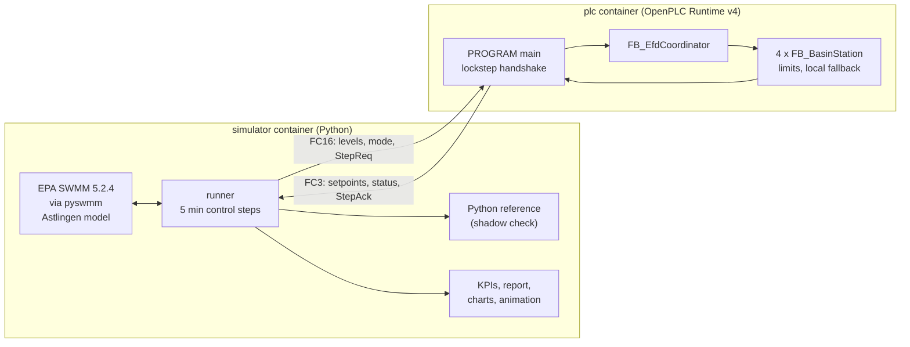
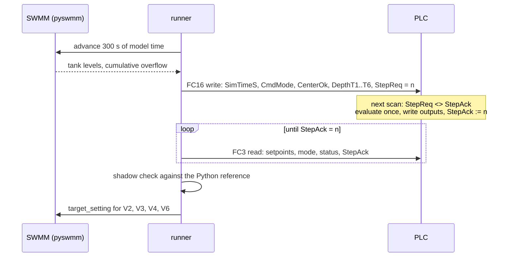
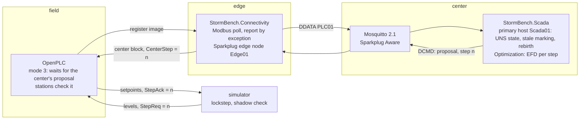
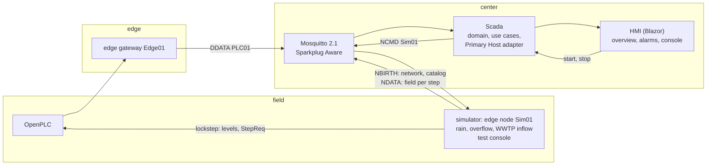
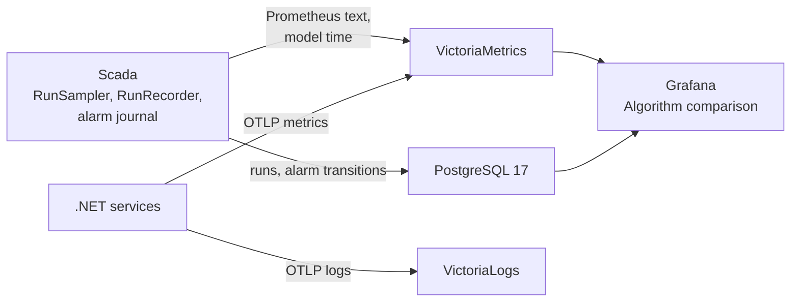
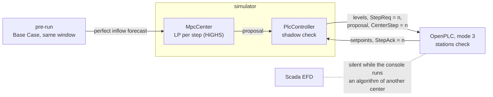

# Architecture

Phase 1: simulator and PLC in lockstep. Phase 2: unified namespace (UNS) and central optimiser. Phase 3: operator HMI and the simulated field on the UNS. Phase 4: a second center and the plugin point.

- **simulator** (`simulator/stormbench_sim`): prepares a runnable copy of the model, advances SWMM one control interval at a time, reads tank levels and cumulative overflow, gets setpoints from a controller and writes them to the orifices. Controllers: SWMM's own rules, the Python reference, or the PLC over Modbus TCP. With the PLC in the loop, the Python reference recomputes every answer for comparison.
- **plc** (`plc/`): IEC 61131-3 Structured Text compiled into the OpenPLC Runtime v4 image at build time (ADR 0002). One coordinator block proposes Equal Filling Degree (EFD) setpoints; four station blocks accept them only within limits and while coordination is healthy, otherwise they run the Base Case locally (ADR 0004).
- **models** (`models/`): the Astlingen benchmark, downloaded from its original repository and verified by hash; never committed.

## One control step

Model time advances only after the PLC has answered, so results do not depend on the speed of either side (ADR 0003, ADR 0006).

## Phase 2: unified namespace and central optimiser

One control step in mode 3 (ADR 0007, ADR 0008):

1. The simulator writes the levels and `StepReq = n`.
2. The gateway sees the new step in its next read of the register image and publishes the changed metrics as DDATA.
3. Scada updates its UNS state and, with the PLC in mode 3 and the center link up, computes EFD from the levels of step n and sends a DCMD.
4. The gateway writes the proposal and `CenterStep = n` in one Modbus request.
5. The PLC stations check the proposal, apply it and acknowledge the step.
6. The simulator reads the setpoints and advances the model.

| Piece | Project | Role |
|---|---|---|
| Sparkplug B 3.0 library | `src/StormBench.Sparkplug` | codec on the Eclipse Tahu schema, edge node, primary host (MQTTnet 5) |
| Names and register map | `src/StormBench.Contracts` | UNS ids, metric names, Modbus map shared by gateway and Scada |
| Edge gateway | `src/StormBench.Connectivity` | PLC to Sparkplug (reads over Modbus or OPC UA), DCMD to PLC over Modbus, DDEATH when the PLC is unreachable |
| Scada | `src/StormBench.Scada` | modules `PrimaryHost` (UNS state) and `Optimization` (EFD), HTTP views `/api/uns`, `/api/optimization`; Phase 3 adds the modules and the HMI below |
| Orchestration | `src/StormBench.AppHost`, `compose.uns.yaml` | Aspire with dashboard, or containers only |

## Phase 3: operator HMI and the simulated field

The HMI never talks to the PLC or the simulator. It shows the application's views of the UNS; test console commands travel as NCMD to `Sim01`, as the center's proposals travel as DCMD to the PLC ([ADR 0010](adr/0010-operator-hmi-from-the-uns.md)).

Scada layers; each depends only on the layers above it:

| Layer | Project | Content |
|---|---|---|
| Domain | `src/StormBench.Domain` | no dependencies: the drainage network (tanks, gates, overflow points, weirs, links) with ids and value objects for volume, fill fraction and gate opening; the scenario and run states; the ISA-18.2 alarm lifecycle (`Alarm`, `AlarmBoard`); Equal Filling Degree and who proposes in mode 3; the overflow KPI |
| Application | `src/StormBench.Application` | use cases behind ports: start and stop a storm, cut or restore the center link, jam a gate, freeze a sensor, acknowledge alarms; queries for the scenario status, KPI, runs and the alarm journal; the site evaluation after every UNS message (run history, alarm conditions, trend, samples) and the central optimiser. Ports: site reader, broker connection, simulator and PLC commands, run store, alarm journal, run series writer, `TimeProvider` |
| Infrastructure | `src/StormBench.Infrastructure` | the Sparkplug Primary Host adapter (`PrimaryHost`: UNS state with quality per metric, rebirth requests, the typed site snapshot, NCMD and DCMD), the run store and alarm journal in PostgreSQL, the historian in VictoriaMetrics ([ADR 0015](adr/0015-historian-and-run-store.md)) |
| Host and presentation | `src/StormBench.Scada` | composition root, HTTP API (`Endpoints/`), Razor components (`Hmi/`): overview display drawn from `Model/Network`, alarm banner and list, console, key figures, trend, the Live 3D view |

## Trends, run history and observability

Scada writes through bounded background queues: a slow or failed store loses data, never a step ([ADR 0015](adr/0015-historian-and-run-store.md), [ADR 0016](adr/0016-observability.md)).

## Phase 4: a second center and the plugin point

A center is anything that implements `runner.Center`: propose one setting per station, observe what the stations applied (ADR 0017, [controllers.md](controllers.md)).

- The MPC (`stormbench_sim/mpc.py`) is one; `--center package.module:factory` loads others.
- Offline, `CenterController` puts a center behind the Python reference of the stations. With the PLC, `PlcController` writes its proposals into the center registers with the step.
- The console catalog states per algorithm which center proposes (`center: scada` or `simulator`); Scada's Optimization module answers only for its own.

## Fault scenarios

Faults use the existing inputs: `CenterOk`, plausibility checks, the status word, the edge node's DDEATH, and the simulator, where gates stick and sensors freeze. Center watchdog: ADR 0011. Field faults: ADR 0012.
